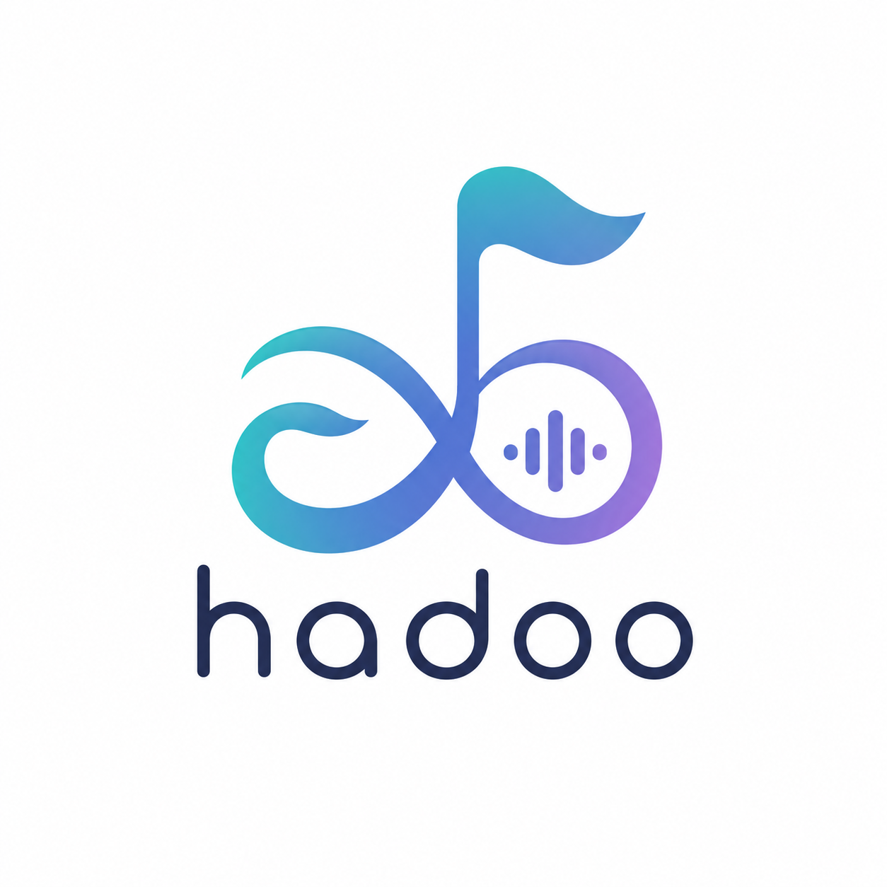

# Hadoo

**Infinite music. Zero noise.**

Hadoo is a standalone music player for Android and iPhone with a terminal-inspired interface and JetBrains Mono. Search YouTube Music as a guest, connect your account for your recommendations and playlists, or play your own files. Save supported tracks for offline listening and make Hadoo playlists that mix recordings from different sources.

## Get started

| I want to… | Start here |
| --- | --- |
| Install or update on Android or iPhone | [Installation and updates](docs/device-setup.md) |
| Set up music, playlists, downloads, and car controls | [User guide](docs/user-guide.md) |
| Fix playback, signing, downloads, or device setup | [Troubleshooting](docs/troubleshooting.md) |
| Build, test, or contribute | [Build from source](docs/build.md) · [Contributing](CONTRIBUTING.md) |
| Check the current version and device coverage | [Changelog](CHANGELOG.md) · [Platform status](docs/mobile-rewrite.md) |

Build **2016** (`2.0.0-dev.17`) is the current source preview on `trunk`. Publishing a [GitHub Release](https://github.com/khushen-vistara-labs/Hadoo/releases) automatically builds an Android APK and an unsigned iPhone IPA for personal signing. Follow the [release steps](docs/maintenance.md#android-release-signing) or [build locally](docs/build.md).

## What you can do

- **Search and listen.** Browse songs, videos, and playlists. Sign in to YouTube Music for your Home recommendations and synced playlists. Source availability depends on the recording, provider, account, and region.
- **Make playlists.** Choose a **Hadoo playlist** for tracks from multiple sources or a **YouTube playlist** to sync with YouTube Music.
- **Listen offline.** Download supported recordings and find them in Downloads. Hadoo also plays local music files and supports background playback.
- **Use car controls.** Android Auto and CarPlay integrations are included. Both still need physical head-unit qualification. CarPlay also requires Apple-approved audio provisioning.

Start with [privacy and data](docs/privacy.md) if you want to see what the app stores and what it sends to enabled services. The [documentation index](docs/README.md) also covers maintainer tasks and the earlier patched APK.

## License

Hadoo's original code is GPL-3.0-only. Distributed copies must carry the applicable notices and corresponding source. Third-party code, fonts, and SDKs retain their applicable terms. See [LICENSE](LICENSE), [NOTICE](NOTICE), and [third-party notices](mobile/THIRD_PARTY_NOTICES.md).
