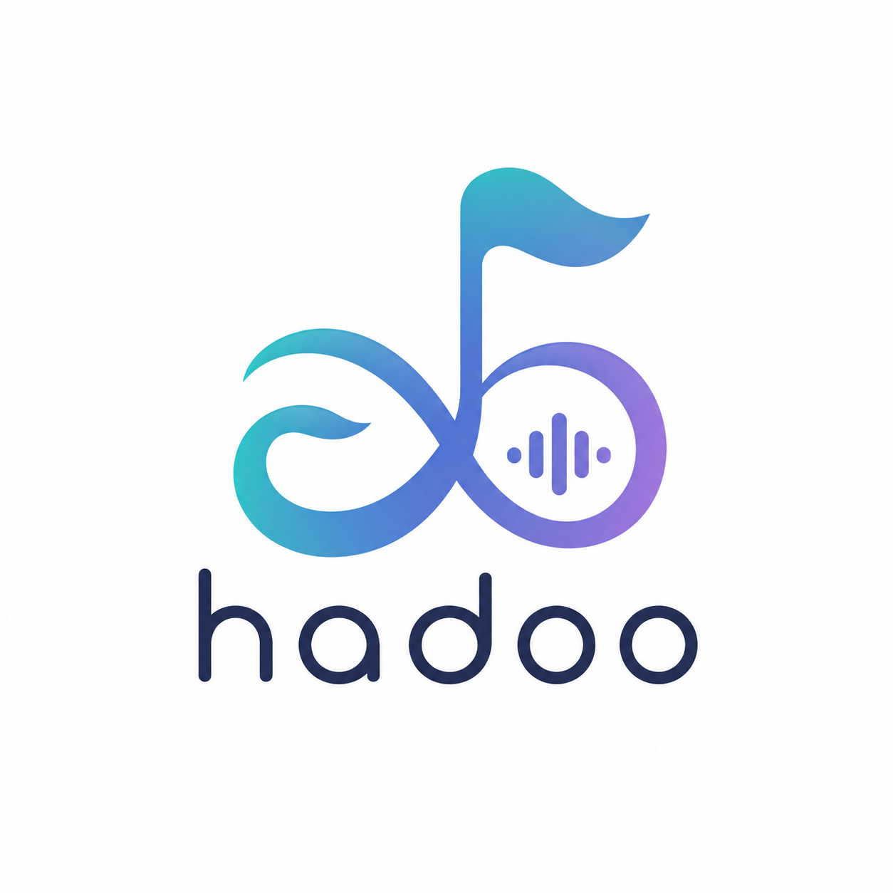
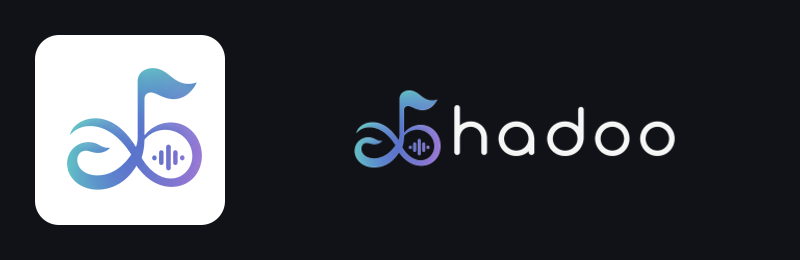

<p align="center"></p>

# Hadoo

Your personal YouTube Music build, with Hadoo's name and artwork.

Hadoo applies a reviewed Morphe patch profile and Hadoo branding to an original
YouTube Music APK that you supply locally. Playback, queues, account integration
and downloads run in the patched YouTube Music app. This replaces the earlier
Expo/React Native implementation.

The repository contains open-source tooling, configuration and branding. Google's
app and source code are not included or relicensed. Generated APKs, original APKs,
signing keys and music remain on your own computer and phone.



## Quick start

Requirements: Python 3.10+, a **Java 21+ JDK**, Android SDK **Build-Tools**
(`aapt2` and `apksigner`), and an original, complete **YouTube Music 9.30.53 APK**.
Android Studio can install the SDK tools. No npm packages or Python packages are
needed. ADB Platform-Tools are optional for USB installation.

```sh
./hadoo doctor
./hadoo setup
./hadoo import-key /path/to/Morphe.keystore
./hadoo build /path/to/youtube-music-9.30.53.apk
./hadoo install
```

**Already using patched YouTube Music?** Export its signing key from Morphe
Manager → Settings → Signing key → Export, then import that file as shown above.
Using the same key lets Hadoo install as an update and retain the app's data.
If Manager shows a different arrangement, look for the Signing key item in its
Backup settings. Do not uninstall your working app to change its branding.

The build checks the source package, supported version and official signing
certificates, verifies both downloaded tools by SHA-256, applies 17 selected
patches plus their dependencies, signs the output, and verifies the resulting
APK. Installation is a separate, explicit command and uses `adb install -r`.

Every build is saved under `.hadoo-local/builds/<timestamp>/Hadoo.apk` with a
`build.json` provenance report and upstream license notices. A failed build does
not replace the last verified output. You can also copy `Hadoo.apk` to your phone
and install it there.

## After installation

The launcher uses **Hadoo** and the original Hadoo symbol. YouTube Music's
interface and playback behavior remain underneath.

### Music-focused setup

On the phone, enable **Settings → Data saving → Don't play music videos**. The
included exclusive-audio patch makes this option available. This is a native
YouTube Music setting, so it is not applied by importing Morphe settings. Enable
**Don't play podcast videos** on the same screen to prefer audio for any podcast
episodes that remain in saved collections.

In **Morphe → General**, set **Start page → Library** and, under
**Navigation bar**, hide **Home**, **Samples** and **Upgrade**. This leaves Search
and Library and avoids starting in the mixed recommendation feed. In **Morphe →
Player**, enable **Hide Audio / Video toggle**. Choose **Songs** in Library and in
search results when browsing recordings.

The corresponding Morphe choices are recorded in `config/phone-settings.json`.
Audio-only playback and hidden video controls do not filter YouTube Music's
entire catalog: video-origin tracks and podcasts may still appear in search or
saved collections. Strictly excluding those results requires another catalog
filter; the stock patches do not provide that guarantee.

The **Play albums songs** patch is intentionally excluded. In the pinned release
it overrides the native Don't play music videos setting when enabled, so combining
them would undermine this profile's audio-only preference.

### Branding and downloads

To select the included Hadoo header, open the app's profile menu → Settings →
Morphe → General → Header logo → Custom. Search settings for “Header logo” if the
menu differs. Under Downloads, choose the in-app download mode if it is not
already selected. Existing user preferences survive an update, so installing an
APK alone does not reset these choices.

When updating an already configured Morphe build, also select **Custom** under
**App name** (this build defines that name as Hadoo) and **Custom** under **App icon**
in its Morphe General settings. You can disable the inherited startup animation
on the same screen.
The new build includes those choices; a previous explicit selection can override
the new build's defaults until you change it once.

The selected Hide ads patch provides switches for hiding video ads, the Get
Premium label and Premium promotions. The Navigation bar patch hides the Upgrade
tab by default. These switches can be checked in the app's Morphe → Ads settings
and Morphe → General → Navigation bar settings. Existing explicit choices are
preserved on update. Hiding offers or enabling local playback features does not
activate a paid Google account membership.

`config/phone-settings.json` records the optional runtime choices for a custom
header, in-app downloads, the “Hadoo settings” menu name, ad and Premium-promotion
hiding, the Library start page, and hidden video/navigation controls. It is separate
from build options; it is not applied silently. You may merge those keys into an
export of your in-app Morphe settings before reimporting. Keep an original export
if you do this; a partial settings import can reset other preferences.

Validate playback, repeated next/previous taps, background playback and downloads
on your device. Test downloads after closing the app and enabling airplane mode.
A successful APK build establishes package integrity, not music-service uptime or
device playback reliability.

## Commands

| Command | Purpose |
| --- | --- |
| `./hadoo doctor` | Find prerequisites and show remaining setup |
| `./hadoo setup` | Download and verify pinned tools; check patches; export branding |
| `./hadoo prepare` | Export branding and options offline using Java |
| `./hadoo patches` | Validate selected patches against the actual pinned bundle |
| `./hadoo import-key PATH` | Copy your existing signing key into private local storage |
| `./hadoo build APK` | Validate, patch, sign and verify an APK |
| `./hadoo build APK --keystore PATH` | Use an existing keystore without copying it |
| `./hadoo build APK --new-key` | Create a new local signing identity on the first build |
| `./hadoo install --serial DEVICE` | Install the last verified build on one USB device |
| `./hadoo check` | Run offline automated tests |

`--new-key` cannot update an app signed by your phone's existing Manager key.
Only use it when you deliberately want a new signing identity. The generated key
is retained for future builds. The tool never uninstalls an app or overwrites a
different imported key.

## Configuration

- `config/hadoo.json`: the Hadoo name, original artwork paths and selected patches.
- `config/upstream-lock.json`: reviewed release URLs, SHA-256 checksums, source
  signing certificates, supported versions and available patch option keys.
- `tools/Branding.java`: deterministic Android resource export. The original PNGs
  stay unchanged; generated resources are sized for each Android display density.
  Lettering uses a clean coverage mask, and reductions average every source pixel
  with its opacity to retain thin strokes without dark or colored fringes.
- `tools/hadoo.py`: dependency-free build, validation, signing and installation CLI.
- `.github/workflows/checks.yml`: source tests, branding export and upstream patch
  compatibility checks. It never builds or uploads Google's app.

Pinned tools: **Morphe Desktop 1.20.0** and **Morphe Patches 2.0.0**. Supported
stable source versions: 9.30.53 (recommended), 9.20.53 and 9.15.51. Upstream updates
require an explicit lock-file change; builds do not silently follow latest.

The patched package ID remains `app.morphe.android.apps.youtube.music`, matching
the standard Morphe GmsCore setup. Its display name is Hadoo. The earlier Hadoo
package, `com.icemonkey.hadoo`, can coexist with it. microG remains installed.

See [device setup](docs/device-setup.md), [maintenance](docs/maintenance.md), and
[contributing](CONTRIBUTING.md).

## License and attribution

Hadoo's original code is GPL-3.0-only; see [LICENSE](LICENSE). Morphe and ReVanced
authorship is acknowledged in [NOTICE](NOTICE), and verbatim upstream notices are
preserved in [third_party](third_party). The downloaded tools and their bundled
code retain their own licenses.

This license does not grant rights to Google's proprietary app, trademarks or
music. Local patching and service use remain subject to applicable rights and
terms. Hadoo is independent of Google, YouTube and Morphe.

Upstream: [Morphe Desktop](https://github.com/MorpheApp/morphe-desktop),
[Morphe Patches](https://github.com/MorpheApp/morphe-patches),
[Morphe Manager documentation](https://github.com/MorpheApp/morphe-manager/tree/main/docs).
